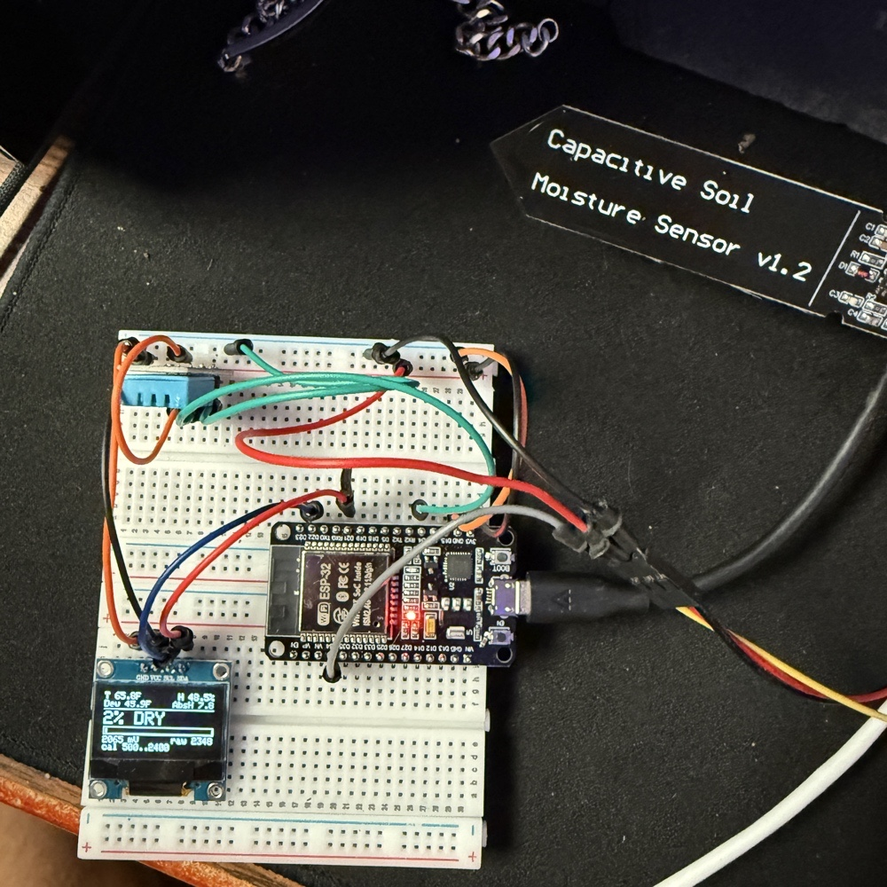
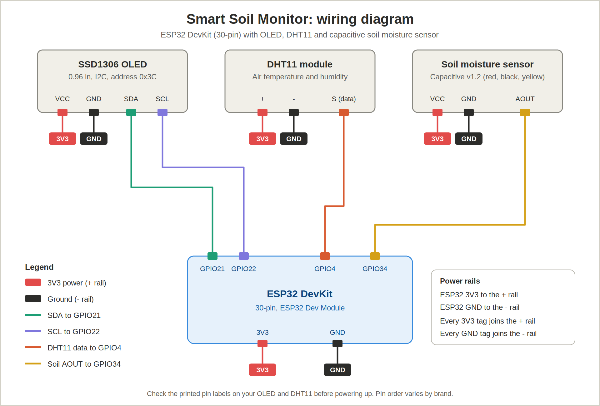

# Smart Soil Monitor (ESP32)

A small embedded system that measures air temperature, air humidity and soil moisture, and shows them on a live OLED dashboard. Built on an ESP32 in C++ (Arduino framework).

(docs/buildwet.jpg)(docs/buildplant.jpg)

## Features

- Air temperature (shown in °F) and relative humidity from a DHT11
- Soil moisture from a capacitive sensor, converted to a 0 to 100 % scale with a DRY / OK / WET label and a progress bar
- Dew point and absolute humidity calculated from the DHT11 readings (Magnus formula)
- Raw ADC value and sensor voltage (mV) shown on screen to make calibration easy
- Readings averaged over several samples to reduce noise; screen refreshes every 3 seconds
- Same data printed to the Serial Monitor for debugging

## Hardware

| Part | Notes |
|---|---|
| ESP32 DevKit (30-pin) | Any ESP32 Dev Module board |
| DHT11 module (3-pin) | Measures **air** temperature and humidity, not soil |
| Capacitive soil moisture sensor v1.2 | Analog output |
| 0.96" SSD1306 OLED, 128x64, I2C | Address `0x3C` |
| 2 breadboards + jumper wires | See the note on breadboards below |

## Wiring

All devices share the ESP32's 3V3 and GND through the breadboard power rails.

| Device pin | Connects to |
|---|---|
| OLED VCC | 3V3 (+ rail) |
| OLED GND | GND (- rail) |
| OLED SDA | GPIO21 |
| OLED SCL | GPIO22 |
| DHT11 + | 3V3 (+ rail) |
| DHT11 - | GND (- rail) |
| DHT11 S (signal) | GPIO4 |
| Soil sensor red (VCC) | 3V3 (+ rail) |
| Soil sensor black (GND) | GND (- rail) |
| Soil sensor yellow (AOUT) | GPIO34 |



**Breadboard note:** a 30-pin ESP32 covers every hole beside its pins on a single small breadboard. Plug one row of its pins into each of two breadboards, side by side, so every pin has free holes next to it.

Pin order and labels vary between OLED and DHT11 brands, so check the printed labels on your parts before powering up.

## Software setup

1. Install the Arduino IDE 2.x.
2. Install the board package **esp32 by Espressif Systems** (Boards Manager) and select **ESP32 Dev Module**.
3. Install these libraries (Library Manager):
   - Adafruit SSD1306 (accept the dependency prompt, which installs Adafruit GFX)
   - DHT sensor library (Adafruit)
   - Adafruit Unified Sensor
4. If no COM port appears when you plug the board in, install the USB-serial driver for your board's chip (CP210x or CH340).
5. Open `soil_monitor/soil_monitor.ino`, choose the board's COM port, and upload. If it stalls at "Connecting....", hold the **BOOT** button until it starts writing.
6. Open the Serial Monitor at **115200** baud.

## Calibration

The percentage is only as accurate as the two calibration values at the top of the sketch:

```cpp
const int SOIL_DRY = 3000;  // raw reading with the sensor dry, in open air
const int SOIL_WET = 1300;  // raw reading with the probe in water (up to the line only)
```

1. Hold the sensor dry in the air and note the **raw** value on screen. Put it in `SOIL_DRY`.
2. Put the probe in water, **only up to the printed line**, and note the raw value. Put it in `SOIL_WET`.
3. Upload again.

Higher raw values mean drier soil. The values above are starting points. Every sensor reads a little differently, so use your own.

## How it works

- **Soil moisture:** the capacitive sensor outputs a voltage that falls as the probe gets wetter. The sketch averages 10 ADC readings (12-bit, 0 to 4095), then maps the result between `SOIL_DRY` and `SOIL_WET` to a 0 to 100 % value, clamped to that range.
- **Dew point and absolute humidity:** calculated from temperature and relative humidity using the Magnus approximation, for display only.
- **Display:** the OLED is driven over I2C with the Adafruit SSD1306 library. A small helper draws left- and right-aligned text on each row, and the progress bar is drawn from the soil percentage.

## Repository layout

```
esp32-soil-monitor/
├── README.md
├── soil_monitor/soil_monitor.ino      main sketch
├── tools/i2c_scanner/i2c_scanner.ino  finds the OLED's I2C address
├── tools/oled_hello/oled_hello.ino    minimal "Hello!" screen test
└── docs/                              wiring diagram and photos
```

Each `.ino` file must sit in a folder with the same name. The Arduino IDE compiles every `.ino` in a folder together, so keep one sketch per folder.

## Limitations

- The DHT11 is a low-cost sensor with roughly ±2 °C and ±5 % RH accuracy and whole-number resolution.
- It measures air, not soil. A waterproof DS18B20 probe would be needed for soil temperature.
- Capacitive moisture sensors vary from unit to unit, so each one needs its own calibration.
- The sensor's electronics are not waterproof. Keep everything above the printed line out of soil and water.

## Ideas for next steps

- Log readings over Wi-Fi (MQTT or a simple web dashboard)
- Add a DS18B20 probe for real soil temperature
- Deep-sleep between readings for battery power
- Enclosure and soldered connections instead of a breadboard

## Lessons learned

This build taught me more through the things that broke than through the parts that worked.

**1. Check the toolchain before the hardware.**
My first upload failed with "Failed to connect to ESP32" because the board was set to an ESP32-C3 profile while the chip was a classic ESP32. Even after fixing that, the upload still failed because the IDE was sending data to COM1, a built-in PC port, not the ESP32. Device Manager showed the board as an unknown "CP2102 USB to UART Bridge" with a warning icon. Installing the Silicon Labs driver created a new COM port, and the upload worked. The takeaway is to confirm the computer can see the board before suspecting the code or the wiring.

**2. Build up in small tests instead of debugging everything at once.**
With all three parts wired at once and nothing on screen, I couldn't tell which one was at fault. I stripped the project down to one part at a time. An I2C scanner confirmed whether the OLED was visible on the bus, a minimal "Hello!" sketch tested the screen alone, and a diagnostic sketch forced every pixel on. The scanner also gave random addresses (like `0xB` and `0x22`) when the screen wasn't powered properly, which showed me the problem was power and wire quality, not software. The screen worked after I rewired onto two breadboards with firm power connections and shorter signal wires.

**3. "Device found" does not mean "working."**
An I2C device can answer its address even when it isn't getting solid power or clean data. Verifying each layer (power, bus, drawing) separately found problems that a single success message hid.

**4. Physical layout matters.**
A 30-pin ESP32 covers every free hole on a small breadboard, so I could not attach wires to some pins. Using two breadboards, with one row of pins in each, fixed it. A loose female jumper that kept falling off the 3V3 pin also caused intermittent faults, so connections need to be solid before debugging code.

**5. Isolate the fault with a simple test.**
The soil sensor kept reading 0 raw on every pin. I touched the loose signal wire to 3V3 and saw the reading jump to 4095. That proved the pin and the code were fine and that the sensor itself was at fault. Later I found the raw value changed when I touched the sensor's back, which means the pin was floating and the number was noise. I had dropped the sensor in water a few times, and water above the printed line damaged its electronics. Replacing it fixed the problem. The takeaway is to find a test that splits the system into "known good" and "suspect" halves.

**6. Calibrate before trusting a number.**
The screen showed "100 % WET" no matter what, even though the code was correct, because the raw values and the calibration range did not match. Displaying the raw value and the voltage next to the percentage made it obvious what the sensor was actually outputting.

**7. Change one thing at a time.**
When I changed the display and the sensor logic in the same edit, the raw readings changed and I couldn't tell why. I went back to the original working code, changed only the display, and compared the two files line by line to confirm that the sensing code was untouched. Keeping the working version and diffing against it saved a lot of guesswork.

**8. Protect the hardware.**
Capacitive moisture sensors have exposed electronics at the top. The sensor should only go in the soil up to the printed line, and the top edge should be sealed against moisture.

**9. Tooling details matter.**
The Arduino IDE compiles every `.ino` file in a sketch folder together, so two versions of the same sketch in one folder produce "redefinition" errors. One sketch per folder avoids it.

## Author

Norbert Kovacs, Computer Engineering at Michigan State University

[LinkedIn](https://linkedin.com/in/norbert-a-kovacs)
